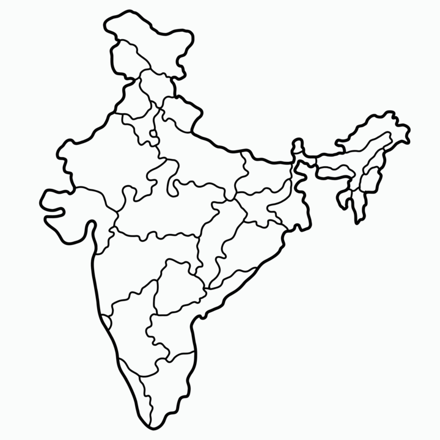

<div align="center">

# 🗺️ India State Quiz Game — Interactive Geography Map Challenge

<p align="center">
  <strong>Interactive Python Turtle geography quiz where players identify Indian states, dynamically plotted on an accurate map coordinate system.</strong>
</p>

<p align="center">
  <a href="#-overview">Overview</a> •
  <a href="#-key-features">Key Features</a> •
  <a href="#-tech-stack--architecture">Tech Stack</a> •
  <a href="#-project-structure">Project Structure</a> •
  <a href="#-getting-started">Getting Started</a>
</p>

<p align="center">
  
  
  
  
</p>

<br/>
<div align="center">
  
</div>
<br/>
</div>

---

## 📌 Overview

**India-State-Quiz-Game** is an educational geographical quiz application powered by Python Turtle Graphics and coordinate data mapping. Players are challenged to name all 28 Indian states, and each correct answer writes the state name directly onto its exact geographic coordinates on an outline map of India.

> [!NOTE]
> This project is designed with native web and programming standards, optimized for fast performance, high readability, and clean modular structure.

---

## ✨ Key Features

- 📍 **Dynamic Geographic Plotting**: Places text labels precisely on the map using real-world calibrated (X, Y) pixel coordinates from `data.csv`.
- 🗺️ **High-Resolution Map Canvas**: Custom `map.gif` canvas displaying the detailed geographical boundaries of India.
- 🏆 **Live Score Tracking**: On-screen prompt displaying current score out of 28 total states (e.g. `14/28 States Correct`).
- 📥 **Missing States Exporter**: Typing 'Exit' immediately exports a list of all un-guessed states into `states_to_learn.csv` for study.
- 🧠 **Case-Insensitive Input**: Automatically normalizes player input using title-case formatting to accept flexible spelling.

---

## 🛠️ Tech Stack & Architecture

| Layer | Technology | Purpose |
| :--- | :--- | :--- |
| **Language** | `Python 3` | Application runtime and game state management |
| **GUI Framework** | `Python Turtle Graphics` | Screen rendering, coordinate mapping, and dialog inputs |
| **Data Mapping** | `Pandas / CSV` | Stores state names and (X, Y) coordinate values in `data.csv` |
| **Visual Asset** | `GIF Image (`map.gif`)` | Geographic outline map of India |

---

## 📂 Project Structure

```text
India-State-Quiz-Game/
├── main.py              # Main quiz engine, input loop, and coordinate renderer
├── data.csv             # 28 Indian states with calibrated (X, Y) coordinates
├── map.gif              # High-definition outline map graphic of India
└── README.md            # Comprehensive documentation
```

---

## 🚀 Getting Started

### Quick Start Instructions

```bash
# Prerequisites: Python 3.8+ and pandas
pip install pandas

# Start the game:
python main.py
```

---

## 💡 How It Works & Usage

1. Run `python main.py`. A window will open showing the outline map of India.
2. An input dialog asks: 'What's another state's name?'.
3. Type any Indian state (e.g., 'Maharashtra', 'Punjab', 'Kerala') and press Enter.
4. If correct, the name appears at its geographical location on the map and your score increments.
5. Type 'Exit' at any point to save your missed states to `states_to_learn.csv`!

---

## 🤝 Contributing & Author

- **Author**: Nikhil ([NikhilCodeWorks](https://github.com/NikhilCodeWorks))
- Contributions, issues, and feature requests are welcome! Feel free to open an issue or pull request.

---

## 📜 License

Distributed under the **MIT License**. See `LICENSE` for more information.
